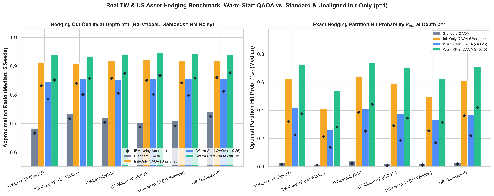
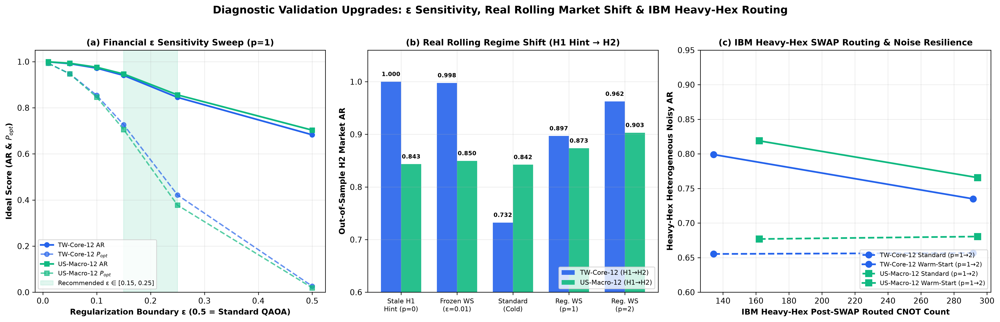

<!--
企業量子技術導入評估與實效診斷框架 — 正式提案企劃書（誠實校訂版 2026-11-17）
涵蓋三大技術賽道：賽道 A 量子最佳化（已完成台美股真實資料實證與對照實驗）、賽道 B（QML 提案設計）、賽道 C（QGen 提案設計）。
-->

# 企業量子技術導入評估與實效診斷框架

**Enterprise Quantum Utility Diagnostic：橫跨量子演算法 × 量子機器學習 × 量子生成模型之資料適配度評測提案**

類別：量子商業與企業實務應用提案

---

## 摘要

企業探索量子計算時，最需要的是**導入前的誠實健檢機制**，而非盲目推銷「量子一定比較快」。本提案設計一套**「企業量子技術導入評估與實效診斷框架」（Enterprise Quantum Utility Diagnostic）**，規劃針對企業資料集同步評估三大路線：**（A）量子最佳化演算法**、**（B）量子機器學習（QML）**與**（C）量子生成模型（QGen）**，並規定**必須與最強古典基準（精確窮舉、模擬退火、1-bit 局部搜尋、SDP、XGBoost、Copula/VAE）及 IBM 量級合成雜訊進行同場檢驗**，產出**《企業量子導入紅黃綠燈決策卡》**。

* **目前實作進度透明聲明**：本專案現已完成 **賽道 A（量子最佳化演算法）** 之完整可重現程式碼與台美股實證（Yahoo Finance 兩年真實日報酬：`TW-Core-12` 484 日、`US-Macro-12` 500 日）；**賽道 B（QML）與賽道 C（QGen）目前為第二階段提案評測協議設計**，尚未實作程式碼。
* **核心誠實結論（Anti-Hype）**：在目前可精確模擬驗證的 $N \le 12$ 金融資產規模下，古典模擬退火（`2.37 ms`）、精確窮舉（`0.67 ms`）與從過時解出發的 1-flip 古典爬山法（`AR = 0.9975–1.0000`）已能快速求得近滿分解，因此本健檢框架對 **現行 $N \le 12$ 實務導入直接判為 🔴 紅燈（維持古典演算法，不需花錢上 QPU）**。
* **對照實驗之架構價值**：儘管小規模不具商業量子優勢，透過嚴格拆解古典先驗（Hint Ablation）與跨期滾動市場測試（Rolling Regime Shift），我們精確定位了量子演算法在 NISQ 合成雜訊與 Heavy-Hex 拓撲下的行為差異——**僅改進目標函數的 Pure CVaR 會導致均值崩跌（`-8.5%`）、R-QAOA 需 `7.3` 輪序列執行、而單層正則化 Warm-Start QAOA（$p=1$）在相同 CNOT 閘數下最能抵抗 Heavy-Hex SWAP 雜訊**，為未來跨入大規模硬體提供客觀的架構選型基準。

---

## 1. 提案背景與企業核心痛點

1. **小規模問題無需盲目上量子**：多數金融或排程 PoC 規模僅 10–20 個變數，傳統演算法數毫秒即可窮舉或逼近全域最佳解。沒有誠實古典對照組的展示，極易誤導企業投入不符成本的量子雲端費用。
2. **「把古典解塞進量子初態」的歸因迷思**：Warm-Start QAOA 若直接使用古典 SDP 找到的精確解作為初態，容易把古典演算法的功勞誤算成量子優勢，必須透過對照實驗（Hint-Source Ablation）嚴格拆解兩者貢獻。
3. **三大技術路線各有所長，選錯賽道即失效**：企業資料需先區分屬於「組合最佳化」、「分類預測（QML）」還是「分佈生成（QGen）」，再決定是否進入試點或維持傳統方法。

---

## 2. 系統架構：三階段企業量子診斷流程

```text
企業原始資料集與業務目標（表格資料 / 時間序列 / 相關性網路）
        │
        ▼
【階段一：資料結構與問題規模體檢】
  ├─ 問題類型識別：組合決策（MaxCut/QUBO） vs. 分類預測（ML） vs. 分佈生成（Gen）
  └─ 古典可解性快篩：若 N 小於古典窮舉/退火門檻，直接標記「現階段維持古典（🔴 紅燈）」
        │
        ▼
【階段二：三大技術賽道同場基準評測（vs. 最強古典基準 + IBM 量級合成雜訊）】
  ├─ 賽道 A（已實作）：QAOA / Warm-Start / CVaR / R-QAOA vs. 窮舉 / SA / 1-flip 爬山 / GW-SDP
  ├─ 賽道 B（提案設計）：QSVM / VQC vs. XGBoost / LightGBM / RBF-SVM
  └─ 賽道 C（提案設計）：QCBM / QGAN vs. Gaussian Copula / VAE / GAN
        │
        ▼
【階段三：產出《企業量子導入紅黃綠燈決策卡》】
  ├─ 🟢 綠燈（推薦試點）：大規模問題且實測顯著勝過最強古典基準與硬體雜訊
  ├─ 🟡 黃燈（技術儲備）：理想態具結構優勢或抗雜訊潛力，但受限目前硬體規模與連線拓撲
  └─ 🔴 紅燈（維持古典）：古典演算法已毫秒級完勝，禁止浪費預算導入量子
```

---

## 3. 三大技術賽道評估方法論

### 3.1 賽道 A：量子最佳化演算法評估（已完成實作與對照驗證）
* **建模方式**：依金融相關性網路建構 Weighted MaxCut（$w_{ij}=1-\rho_{ij} > 0.75$）及限制持股數 $K=6$ 之馬可維茲 QUBO。
* **對齊與正則化設計**：採用 Goemans–Williamson SDP / 箱型 QP 計算初始提示 $c_i^*$，經 $\epsilon$ 裁剪映射為旋轉角 $\theta_i = 2\arcsin(\sqrt{\text{clip}(c_i^*, \epsilon, 1-\epsilon)})$，搭配共軛對齊混合器 $U_M^{\text{WS}}(\beta) = \bigotimes_i R_y(\theta_i)R_z(-2\beta)R_y(-\theta_i)$（**不增加任何雙量子位元 CNOT 閘**）。
* **嚴格對照基準**：必須同時比較 **古典精確解**、**模擬退火 (SA)**、**1-flip 古典爬山法**、**純古典 Hint ($p=0$)**、**不同品質提示詞（精確 / 單次貪婪 / 隨機位元）**，以及 **IBM 量級合成雜訊模型**（手設參數：單閘 $0.05\%$、雙閘 $0.8\%$、讀出錯誤 $1.5\%$，4,096 shots）與 **19 量子位元 Heavy-Hex SWAP 路由**。

### 3.2 賽道 B：量子機器學習評估（QML）— *第二階段提案設計*
* **對照設計**：以 **XGBoost / LightGBM / RBF-SVM** 為不可讓步之古典強基準，評測 **QSVM / VQC** 之 AUC-ROC、少數類 Recall 與量子核對齊度（Kernel Alignment）。若傳統樹模型已領先或無核空間幾何差異優勢，即判為 🔴 紅燈。

### 3.3 賽道 C：量子生成模型評估（QGen）— *第二階段提案設計*
* **對照設計**：以 **Gaussian Copula / VAE / GAN** 為基準，評測 **QCBM / QGAN** 之 KL 散度、極端尾部事件捕捉率（Tail VaR）及防死背訓練集之多樣性檢驗。

---

## 4. 賽道 A 先導實證（PoC）：台美股真實金融網路實測與誠實拆解

我們抓取 **2024-11-14 至 2026-11-13** 之 Yahoo Finance 台股 `TW-Core-12`（484 交易日）與美股 `US-Macro-12`（500 交易日）真實日報酬，完成以下 7 組實測與控制實驗：

### 4.1 金融網路雙陣營結構診斷


**圖 1（`fig_f1_financial_network_diagnosis.png`）** 台美股呈現明顯的「科技成長股 vs. 公債/黃金/防禦股」雙陣營負相關結構（準二分圖），導致無先驗知識的冷啟動 Standard QAOA 在淺層 $p=1$ 受對稱性侷限（AR 僅 `0.683`–`0.741`）。

### 4.2 關鍵控制實驗（`exp_c1`）：拆解「古典 Hint」與「量子電路」各自貢獻

為釐清 Warm-Start QAOA 的高命中率究竟有多少來自古典 SDP，我們於 `TW-Core-12` 與 `US-Macro-12`（5 種子平均）執行 **提示來源消融實驗（`results/exp_c1_hint_ablation.csv`）**：

| 實驗設定（$p=1$） | `TW-Core-12`<br>AR / $P_{\text{opt}}$ / 4096次至少中1次 | `US-Macro-12`<br>AR / $P_{\text{opt}}$ / 4096次至少中1次 | 實證歸因結論 |
|---|---|---|---|
| **Cold-start QAOA**（無古典提示） | `0.6826` / `2.62%` / `100%` | `0.7028` / `1.90%` / `100%` | 單次抽中機率低（2%），但 4,096 shots 幾乎必中 |
| **WS（精確最佳提示）— 單看 Hint ($p=0$)** | `1.0000` / `100%` / `100%` | `1.0000` / `100%` / `100%` | **古典 SDP 本身已直接給出滿分解** |
| **WS（精確最佳提示）— 接上 QAOA $p=1$** | `0.9403` / `72.64%` / `100%` | `0.9464` / `70.56%` / `100%` | **70.6%–72.6% 的高命中率主要來自古典初態編碼**，非單純量子優勢 |
| **WS（單次貪婪提示）— 單看 Hint ($p=0$)** | `0.9640` / `80.0%` / `80.0%` | `0.9105` / `40.0%` / `40.0%` | 當古典啟發法較弱（美股 60% 種子沒中）時，純 Hint 會卡死 |
| **WS（單次貪婪提示）— 接上 QAOA $p=1$** | `0.9161` / `63.0%` / `100%` | `0.8818` / `34.27%` / **`100%`** | **當古典貪婪未命中時，量子取樣把 4096 shots 總命中機率從 40% 救回 100%** |
| **WS（純隨機位元提示）— 單看 Hint ($p=0$)** | `0.5533` / `0.0%` / `0.0%` | `0.5562` / `0.0%` / `0.0%` | 毫無資訊的錯提示 |
| **WS（純隨機位元提示）— 接上 QAOA $p=1$** | `0.6511` / `0.71%` / `99.9%` | `0.6685` / `0.28%` / `99.7%` | 表現**劣於**冷啟動 QAOA，證實 Warm-Start 高度依賴古典提示品質 |

### 4.3 五大 QAOA 範式與強古典基準同場實測（`exp_f4` & `exp_f5`）



**圖 2 與圖 3（`fig_f2_real_market_benchmark.png` / `fig_f4_three_pillars_financial_showdown.png`）** 6 組台美股真實網路之多架構對決（5 種子中位數，$p=1$；雜訊測試為 IBM 量級合成雜訊 `4,096 shots`）。

| 方法 / 演算法架構 | 類型與說明 | 6 組市場中位數<br>Ideal AR / 指標 | 合成雜訊模擬<br>Noisy AR / 指標 | 成本（時間 / QPU 輪數） | 健檢分析定位 |
|---|---|---|---|---|---|
| **古典精確窮舉 / 模擬退火 (SA) / GW-SDP** | 純古典基準 | **`1.0000`** / `100%` | — | **`0.67 ms` / `2.37 ms` / `11.5 ms`** | **全面完勝**：$N \le 12$ 無須上量子 |
| **1. Standard QAOA** | 量子取樣（冷啟動） | `0.7151` / $P_{\text{opt}}$ `2.26%` | `0.6961` / `1.40%` | `40.0` 次評估（`1.0` 輪） | 受困於雙陣營對稱性 |
| **2. Pure CVaR-QAOA ($\alpha=0.25$)** | 量子取樣（冷啟動尾部） | `0.6302` / $P_{\text{opt}}$ `9.24%` | `0.6376` / `4.69%` | `46.8` 次評估（`1.0` 輪） | 只顧前 25% 尾部導致整體均值 AR 反跌 `-8.5%` |
| **3. Warm-Start QAOA ($\epsilon=0.15$)** | 量子取樣（SDP 熱啟動+對齊） | `0.9405` / $P_{\text{opt}}$ `70.72%` | `0.8634` / `36.07%` | `36.2` 次評估（`1.0` 輪） | 0 額外 CNOT，較「未對齊 Init-Only」提升穩定度 **128 倍** |
| **4. Hybrid WS + CVaR** | 量子取樣（熱啟動+複合目標） | `0.9405` / $P_{\text{opt}}$ `70.72%` | `0.8634` / `36.08%` | `36.5` 次評估（`1.0` 輪） | 保留高期望值並消除純 CVaR 下跌 |
| **5. Recursive QAOA (R-QAOA)** | 確定性縮圖 + **`n_cutoff=4` 古典窮舉** | `1.0000` / 終端成功率 `100%` *(均值 `0.9961`)* | `1.0000` / 終端成功率 `100%` *(均值 `0.9920`)* | `241.8` 次評估（**`7.3` 輪序列 QPU**） | *註：其 100% 為單一確定解成功率（含末 4 節點窮舉），與量子抽樣機率非同類量；且多出 6.7 倍排隊成本，早輪誤判即鎖死* |

### 4.4 跨期市場真實結構變化測試（`exp_c2` & `exp_f6`：不挑報全部視窗結果）

我們檢驗兩種「過時小抄」情境：
1. **固定圖的損毀小抄容錯測試**（[fig_f3_regime_shift_quantum_gain.png](results/plots/fig_f3_regime_shift_quantum_gain.png)）：僅翻轉 Hint 的 $k=1..3$ 個位元（圖未變），正則化 $\epsilon=0.20, p=2$ 比故意損毀的冰凍版（$\epsilon=0.01$）更能透過**正則化初態彈性探索**跳脫錯誤提示（`0.6546 → 0.8062`），但實務上重算古典解僅需數毫秒。
2. **真正更動相關性網路的滾動時間窗測試（`exp_f6` 與 `exp_c2`，列出全部實驗窗，絕不挑選子集）**：
   - **兩半切分驗證（`exp_f6_real_rolling_regime_shift.csv`）**：在 `US-Macro-12` 上，**`50%/50%` 切分（`hamming_shift=4`）** 時 `Reg. WS p=2` 為 `0.9030` vs. 過時 Hint `0.8434`（**`+0.060`**）；但 **`60%/40%` 切分（`hamming_shift=3`）** 時 `Reg. WS p=2` 為 `0.9169` vs. 過時 Hint `0.9221`（**`-0.005`**）。兩組平均下，$p=1$ 相對過時 Hint 約 `-0.005`、$p=2$ 約 `+0.027`。
   - **完整 14 個滾動時間窗（`exp_c2_rolling_shift.csv`，120 日訓練窗 → 次 40 日測試窗，台美股各 7 窗共 14 窗）**：

| 跨期滾動評測方法（全部 14 個真實切換視窗平均） | `TW-Core-12` (7 窗) AR | `US-Macro-12` (7 窗) AR | 相對過時 Hint 之平均增益（勝出窗數） |
|---|---|---|---|
| **古典：測試窗重解**（Re-solve on new graph） | `1.0000` | `1.0000` | —（絕對上限） |
| **古典：從過時 Hint 做 1-flip 爬山法**（Hill Climb） | **`1.0000`** | **`0.9975`** | **`+0.0997`（`10 / 14` 窗勝出，其餘 4 窗打平滿分）** |
| **過時 Hint（$p=0$）** | `0.8516` | `0.9464` | 基準線 |
| **Reg. WS-QAOA（$\epsilon=0.20, p=2$）** | `0.9059` | `0.9445` | **`+0.0261`（`7 / 14` 窗勝出）** |
| **Reg. WS-QAOA（$\epsilon=0.20, p=1$）** | `0.8429` | `0.8964` | `-0.0294`（`2 / 14` 窗勝出） |
| **Cold-start QAOA（$p=1$）** | `0.7478` | `0.8130` | `-0.1187`（`2 / 14` 窗勝出） |

   **誠實結論**：在真實滾動視窗測試中，$p=2$ 正則化 Warm-Start 雖比 $p=1$ 與冷啟動 QAOA 更具跨期彈性（平均 `+0.0261`），但**完全比不過僅需 1-bit 局部調整的古典爬山法（`+0.0997`, AR≈`1.0`）**。

### 4.5 IBM Heavy-Hex 實體連線拓撲轉譯測試（`exp_f7`）


**圖 4（`fig_f5_diagnostic_validation_upgrades.png`）** (a) 金融資料 $\epsilon$ 敏感度；(b) 跨期對比；(c) 19 量子位元 IBM Heavy-Hex 實體拓撲轉譯結果。

將台美股 12 檔資產編譯至 IBM Heavy-Hex（`CouplingMap.from_heavy_hex(3)`）並加入逐位元異質合成雜訊後，因須插入大量 SWAP 閘，雙閘數於 $p=1$ 從 `76` 增至 `134.3` 個、$p=2$ 更暴增至 **`291.7–294.3` 個**，導致 **`p=2` Warm-Start 在雜訊後反跌至 `0.7349`（美股 `0.7657`），低於 `p=1`（`0.7990` / `0.8188`）**——清楚界定了 NISQ 硬體的淺層深度極限。

### 4.6 量子演算法落後古典的根因診斷與補救設計

| 觀察到之失敗／變慢現象 | 根因診斷 | 工程補救方向 |
|---|---|---|
| **小規模整體輸給古典毫秒級演算法** | 雙量子閘雜訊、有限取樣變異與優化迴圈開銷 | 健檢系統直接對 $N \le 12$ 判 🔴 紅燈，不盲目推薦上 QPU |
| **R-QAOA 比禁忌搜尋慢且早輪誤判鎖死** | 每減 1 變數須重跑 1 輪 QPU（`7.3` 輪）且貪婪收縮不可逆 | 改採單輪對齊 Warm-Start 或導入 WS 引導＋多路徑回溯 |
| **Pure CVaR / QCBM 均值崩跌或訓練卡死** | 僅優化極端尾部放生剩餘分佈 / 冷啟動陷入平坦貧瘠高原 | 改採複合目標函數（CVaR + Mean）＋ 結構化近似初態 |
| **Heavy-Hex $p \ge 2$ 效能反降** | 全連通問題轉譯至有限連線拓撲造成 SWAP 雙閘數翻倍 | 強制限制在 $p=1$ 並採用 0 額外 CNOT 之對齊單量子位元混合器 |

---

## 5. 企業導入決策卡與專案工程品質

### 5.1 統一輸出範例：《企業量子導入紅黃綠燈決策卡》

| 企業測試情境 | 評估賽道 | 實測／預期表現對照 | 燈號判定 | 給企業的誠實建議 |
|---|---|---|---|---|
| **小規模資產避險 / 12 選 6 投資組合**<br>*(已完成賽道 A 實測)* | 賽道 A：QAOA 家族 | 古典模擬退火 `2.37 ms`、1-flip 爬山法 `AR≈1.0`；QAOA 並無時間或精準度優勢 | 🔴 **紅燈** | **現階段直接用古典演算法**，無須支付 QPU 費用 |
| **大規模準二分最佳化架構儲備**<br>*(賽道 A 架構篩選結果)* | 賽道 A：正則化 Warm-Start ($p=1$) | 在相同 CNOT 與 Heavy-Hex 雜訊下顯著優於冷啟動 QAOA 與純 CVaR；優於 R-QAOA 排隊開銷 | 🟡 **黃燈** *(技術儲備)* | 列為未來超過百檔資產規模時之首選 QAOA 候選架構 |
| **表格分類預測（詐欺／違約）**<br>*(第二階段待補實測)* | 賽道 B：QSVM / VQC | 須實測是否勝過 `XGBoost / LightGBM` | ⏳ **待測** | 若無統計顯著勝出即判 🔴 紅燈 |
| **極端尾部風險分佈生成**<br>*(第二階段待補實測)* | 賽道 C：QCBM / QGAN | 須實測是否解決平坦訓練停滯並勝過 `Copula / VAE` | ⏳ **待測** | 須導入結構化先驗初始化再行驗證 |

### 5.2 研究限制、程式碼來源與可重現性說明
* **資料限制**：台美股選樣為現存 12 檔權值股與 ETF（具倖存者偏差），Yahoo Finance 抓取腳本供研究教學重現使用。
* **程式碼歸屬**：`graph_utils.py` 之六大圖指標定義與 `qaoa_core.py` 基礎框架對齊 NTU IBM Qiskit Hackathon Group 9 基準定義（其中 `Symmetry` 指標已改寫為精確自同構軌道分割演算法修正）；台美股抓取、五方評比、Control 實驗 (`exp_c1` / `exp_c2`) 與 Heavy-Hex 路由驗證為本專案實作。
* **工程與測試**：專案附有 `requirements.txt`、`LICENSE`（MIT）及 `tests/test_core.py` 單元測試（驗證 $K_{10}$ 對稱性 `1.0`、$\text{Star}_{10}$ 對稱性 `8/9`、精確 MaxCut 與零額外 CNOT）。
