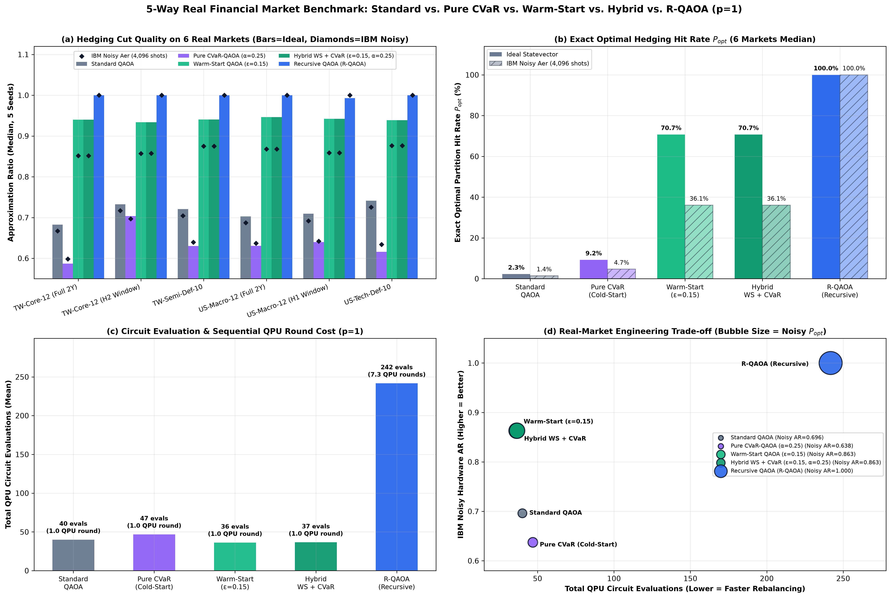

<!--
企業量子技術導入評估與實效診斷框架 — 正式提案企劃書（嚴格校訂版 2026-11-17）
涵蓋三大技術賽道：賽道 A 量子最佳化（已完成台美股真實資料實證與對照實驗）、賽道 B（QML 提案設計）、賽道 C（QGen 提案設計）。
-->

# 企業量子技術導入評估與實效診斷框架

**Enterprise Quantum Utility Diagnostic：橫跨量子演算法 × 量子機器學習 × 量子生成模型之資料適配度評測提案**

類別：量子商業與企業實務應用提案

---

## 摘要

企業探索量子計算時，最需要的是**導入前的客觀健檢機制**，而非預設立場推銷「量子一定比較快」。本提案設計一套**「企業量子技術導入評估與實效診斷框架」（Enterprise Quantum Utility Diagnostic）**，規劃針對企業資料集同步評估三大路線：**（A）量子最佳化演算法**、**（B）量子機器學習（QML）**與**（C）量子生成模型（QGen）**，並規定**必須與最強古典基準（精確窮舉、模擬退火、1-flip 局部爬山法、GW-SDP、均勻隨機抽樣、XGBoost、Copula/VAE）及 IBM 量級合成雜訊進行同場檢驗**，最終產出**《企業量子導入紅黃綠燈決策卡》**。

* **實作進度透明聲明**：本專案現已完成 **賽道 A（量子最佳化演算法）** 之完整可重現程式碼與台美股實證（Yahoo Finance 兩年真實日報酬：`TW-Core-12` 484 日、`US-Macro-12` 500 日）；**賽道 B（QML）與賽道 C（QGen）目前為第二階段提案評測協議設計**，尚未實作程式碼。
* **核心誠實結論（Anti-Hype）**：
  1. **小規模與準二分結構皆判 🔴 紅燈（維持古典）**：在 $N \le 12$ 規模下，總狀態空間僅 $2^{12}=4096$ 種（連純隨機盲猜 4,096 次都有 `86.5%` 機率至少中 1 次最佳解），且古典精確窮舉（`0.67 ms`）、模擬退火（`2.37 ms`）、GW-SDP（`11.5 ms`）與從過時解出發的 1-flip 古典爬山法（`AR = 0.9975–1.0000`）皆能毫秒級求解。此外，二分圖具線性時間二著色解、準二分圖對古典 SDP 亦極容易，即使擴大規模也無須動用量子電腦。
  2. **嚴格拆解各演算法機制與指標定位**：透過提示來源消融（`exp_c1`）與 5 大 QAOA 架構評比（`exp_f4`），我們實證：（a）Warm-Start QAOA 的高單次命中率（`70.7%`）主要來自將古典 SDP 解編碼進初態，但必須搭配**共軛對齊混合器**才不會洗出先驗資訊（較未對齊版提升穩定度 128 倍）；（b）**Pure CVaR-QAOA（$\alpha=0.25$）** 的設計目標是優化前 25% 尾部而非全體平均——若以它自己的目標指標 $\text{CVaR}_{0.25}$ 評量，它確實優於冷啟動標準 QAOA（理想態 `0.8462 → 0.8886`、合成雜訊下 `0.8183 → 0.8481`、單次 $P_{\text{opt}}$ 提升 `4.1` 倍），代價是犧牲後 75% 分佈使全體均值 AR 較低（`0.6302`）；（c）在 19-qubit Heavy-Hex 拓撲轉譯下，$p=2$ 因 SWAP 雙閘翻倍（`~292` 個 CNOT）使雜訊後表現反低於 $p=1$，界定了 NISQ 電路深度上限。

---

## 1. 提案背景與企業核心痛點

1. **缺乏強古典基準與盲猜基線的評估容易失真**：在 $N=12$ 等小規模 PoC 中，解空間僅 $2^{12}=4096$，若不放入「均勻隨機盲猜（4096 次抽樣）」與「毫秒級古典局部搜尋（1-flip hill climbing / SA）」作為基線，極易將小規模抽樣覆蓋率或古典初態的功勞誤判為量子優勢。
2. **評估指標必須對齊演算法設計目標**：例如 CVaR-QAOA 專注於極端尾部樣本品質（$\text{CVaR}_\alpha$），R-QAOA 屬於多輪確定性變數消去加古典窮舉收尾，而標準／熱啟動 QAOA 則是單輪機率分佈抽樣。若未同時報告各自對應指標（$\text{CVaR}_{0.25}$、均值 AR、單次 $P_{\text{opt}}$ 與 QPU 輪數），會造成指標錯配（Metric Mismatch）。
3. **圖結構決定古典難易度**：二分圖（Bipartite）可由古典二著色於線性時間內精確求解，準二分圖（Quasi-Bipartite）亦能被古典半定規劃（GW-SDP）高度逼近；真正的量子候選場域必須鎖定在「古典近似間隙大、具高幾何挫折（Frustration）且規模超過古典極限」的問題。

---

## 2. 系統架構：三階段企業量子診斷流程

```text
企業原始資料集與業務目標（表格資料 / 時間序列 / 相關性網路）
        │
        ▼
【階段一：資料結構與古典可解性體檢】
  ├─ 問題類型識別：組合決策（MaxCut/QUBO） vs. 分類預測（ML） vs. 分佈生成（Gen）
  └─ 古典易解性快篩：若 N 小於古典窮舉/局部搜尋門檻，或圖結構屬二分/準二分（SDP 易解），直接判 🔴 紅燈
        │
        ▼
【階段二：三大技術賽道同場基準評測（vs. 最強古典基準 + IBM 量級合成雜訊）】
  ├─ 賽道 A（已實作）：QAOA / Warm-Start / CVaR / R-QAOA vs. 盲猜 / 窮舉 / SA / 1-flip 爬山 / GW-SDP
  ├─ 賽道 B（提案設計）：QSVM / VQC vs. XGBoost / LightGBM / RBF-SVM
  └─ 賽道 C（提案設計）：QCBM / QGAN vs. Gaussian Copula / VAE / GAN
        │
        ▼
【階段三：產出《企業量子導入紅黃綠燈決策卡》】
  ├─ 🟢 綠燈（推薦試點）：古典近似失效之高複雜度問題，且量子方法於雜訊下具統計顯著優勢
  ├─ ⏳ 待測（需大規模或實機驗證）：小規模機制驗證完成，尚待高挫折大圖或百位元實機驗證
  └─ 🔴 紅燈（維持古典）：古典演算法已毫秒級完勝或結構上對古典容易，無須浪費量子預算
```

---

## 3. 三大技術賽道評估方法論

### 3.1 賽道 A：量子最佳化演算法評估（已完成實作與控制實驗）
* **建模方式**：依金融相關性網路建構 Weighted MaxCut（$w_{ij}=1-\rho_{ij} > 0.75$）及限制持股數 $K=6$ 之馬可維茲 QUBO。
* **對齊與正則化設計**：採用 Goemans–Williamson SDP / 箱型 QP 計算初始提示 $c_i^*$，經 $\epsilon$ 裁剪映射為旋轉角 $\theta_i = 2\arcsin(\sqrt{\text{clip}(c_i^*, \epsilon, 1-\epsilon)})$，搭配共軛對齊混合器 $U_M^{\text{WS}}(\beta) = \bigotimes_i R_y(\theta_i)R_z(-2\beta)R_y(-\theta_i)$（**不增加任何雙量子位元 CNOT 閘**）。
* **多維度公平指標**：同時評估 **全體平均近似比（Mean AR）**、**前 25% 尾部近似比（$\text{CVaR}_{0.25}$）**、**單次測量最佳解機率（Single-shot $P_{\text{opt}}$）**，並與 **4,096 次均勻盲猜**、**1-flip 古典爬山法**、**模擬退火 (SA)**、**IBM 量級合成雜訊**（手設參數：單閘 $0.05\%$、雙閘 $0.8\%$、讀出錯誤 $1.5\%$）及 **19-qubit Heavy-Hex SWAP 路由**進行對照。

### 3.2 賽道 B：量子機器學習評估（QML）— *第二階段提案設計*
* **對照設計**：以 **XGBoost / LightGBM / RBF-SVM** 為古典強基準，在嚴格交叉驗證下評測 **QSVM / VQC** 之 AUC-ROC、少數類 Recall 與量子核對齊度（Kernel Alignment）。若傳統樹模型已領先則判為 🔴 紅燈。

### 3.3 賽道 C：量子生成模型評估（QGen）— *第二階段提案設計*
* **對照設計**：以 **Gaussian Copula / VAE / GAN** 為基準，評測 **QCBM / QGAN** 之對數概似 / KL 散度、極端尾部事件捕捉率（Tail VaR）及防死背訓練集之泛化能力。

---

## 4. 賽道 A 先導實證（PoC）：台美股真實金融網路實測與嚴格控制實驗

我們抓取 **2024-11-14 至 2026-11-13** 之 Yahoo Finance 台股 `TW-Core-12`（484 交易日）與美股 `US-Macro-12`（500 交易日）真實日報酬，完成以下控制實驗與架構評比：

### 4.1 金融網路雙陣營結構診斷（為何對冷啟動 QAOA 難、對古典 SDP 易）


**圖 1（`fig_f1_financial_network_diagnosis.png`）** 台美股呈現「科技成長股 vs. 公債/黃金/防禦股」雙陣營負相關結構（準二分圖）。此結構有兩個重要特性：
1. **對冷啟動 Standard QAOA 不利**：均勻初態 $|+\rangle^{\otimes n}$ 在 $p=1$ 受局部視野與全域對稱性限制，AR 僅 `0.683–0.741`。
2. **對古典演算法極為容易**：純二分圖可由二著色於線性時間求解，準二分圖之古典 GW-SDP 鬆弛亦幾乎無間隙（`AR = 1.000`）。因此**準二分結構本身並非量子計算超越古典的場域，而是用來檢驗熱啟動如何將古典先驗無損編碼進淺層量子電路的測試案例**。

### 4.2 控制實驗一（`exp_c1`）：含「均勻盲猜基線」之提示來源消融實驗

為拆解 Warm-Start QAOA 的表現有多少來自古典提示本身，並檢驗 $N=12$ 下 `4,096 shots` 的統計意義，我們於 `TW-Core-12` 與 `US-Macro-12`（5 種子平均）執行 **`results/exp_c1_hint_ablation.csv`**：

| 實驗設定（$p=1$） | `TW-Core-12`<br>Mean AR / 單次 $P_{\text{opt}}$ / 4096次至少中1次 | `US-Macro-12`<br>Mean AR / 單次 $P_{\text{opt}}$ / 4096次至少中1次 | 實證歸因結論 |
|---|---|---|---|
| **Classical: uniform random sampling**<br>（純古典均勻隨機盲猜） | — / `0.05%` / **`86.47%`** | — / `0.05%` / **`86.47%`** | **關鍵基線**：12 qubits 總共僅 $2^{12}=4096$ 種狀態（2 個最佳解），**盲猜 4096 次本來就有 86.5% 機率至少中 1 次**，故 `hit_in_4096` 在 $N=12$ 接近 100% 屬解空間太小的自然結果 |
| **Cold-start QAOA $p=1$**（無古典提示） | `0.6826` / `2.62%` / `100%` | `0.7028` / `1.90%` / `100%` | 單次抽中機率僅約 2%（高於盲猜 `0.05%`） |
| **WS（精確最佳提示）— 單看 Hint ($p=0$)** | `1.0000` / `100%` / `100%` | `1.0000` / `100%` / `100%` | **古典 SDP 本身已直接給出滿分解** |
| **WS（精確最佳提示）— 接上 QAOA $p=1$** | `0.9403` / `72.64%` / `100%` | `0.9464` / `70.56%` / `100%` | **70.6%–72.6% 的單次命中率來自古典初態編碼**；因 $\epsilon=0.15$ 保留疊加態，Mean AR 略低於純 Hint (`1.000`) |
| **WS（單次貪婪提示）— 單看 Hint ($p=0$)** | `0.9640` / `80.0%` / `80.0%` | `0.9105` / `40.0%` / `40.0%` | 確定性單一貪婪解：美股 5 個種子中有 2 個找到最佳解（40%）、3 個落入次優解 |
| **WS（單次貪婪提示）— 接上 QAOA $p=1$** | `0.9161` / `63.00%` / `100%` | `0.8818` / `34.27%` / `100%` | QAOA 將機率分佈在貪婪解周圍展開：全體平均 AR（`0.8818`）與單次 $P_{\text{opt}}$（`34.27%`）皆略低於貪婪提示本身（`0.9105` / `40%`），在貪婪未命中的種子提供非零抽樣機率，但 4096 次命中 100% 主要是因解空間僅 4096 |
| **WS（純隨機位元提示）— 單看 Hint ($p=0$)** | `0.5533` / `0.0%` / `0.0%` | `0.5562` / `0.0%` / `0.0%` | 毫無資訊的隨機起點 |
| **WS（純隨機位元提示）— 接上 QAOA $p=1$** | `0.6511` / `0.71%` / `99.9%` | `0.6685` / `0.28%` / `99.7%` | 單次 $P_{\text{opt}}$（`0.28%–0.71%`）與 Mean AR 皆**劣於冷啟動 QAOA**，證實錯誤提示反而拖累表現 |

### 4.3 五大 QAOA 範式與強古典基準同場實測（同時報告 Mean AR 與 $\text{CVaR}_{0.25}$）



**圖 2 與圖 3（`fig_f2_real_market_benchmark.png` / `fig_f4_three_pillars_financial_showdown.png`）** 6 組台美股真實網路之多架構對決（5 種子中位數，$p=1$；雜訊測試為手設 IBM 量級合成雜訊 `4,096 shots`）。

為避免用「全體平均 AR」單一指標錯判專為優化尾部設計的 `Pure CVaR-QAOA`，下表同時列出 **全體平均近似比（Mean AR）** 與 **前 25% 尾部平均近似比（$\text{CVaR}_{0.25}$）**（數據出自 `results/exp_f4_full_5way_financial_benchmark.csv` 與 `exp_f5_classical_vs_quantum_baselines.csv`）：

| 方法 / 演算法架構 | 理想態中位數<br>Mean AR / **$\text{CVaR}_{0.25}$** / $P_{\text{opt}}$ | 合成雜訊中位數<br>Mean AR / **$\text{CVaR}_{0.25}$** / $P_{\text{opt}}$ | 成本（時間 / 評估數） | 指標公平解讀與定位 |
|---|---|---|---|---|
| **古典窮舉 / 模擬退火 (SA) / GW-SDP** | **`1.0000`** / **`1.0000`** / `100%` | — | **`0.67` / `2.37` / `11.5 ms`** | **小規模絕對王者**：毫秒級滿分，$N \le 12$ 判 🔴 紅燈 |
| **1. Standard QAOA**<br>（冷啟動 + 優化 Mean AR） | `0.7151` / **`0.8462`** / `2.26%` | `0.6961` / **`0.8183`** / `1.40%` | `40.0` 次評估（`1.0` 輪） | 冷啟動基準線 |
| **2. Pure CVaR-QAOA ($\alpha=0.25$)**<br>（冷啟動 + 優化前 25% 尾部） | `0.6302` / **`0.8886`** / **`9.24%`** | `0.6376` / **`0.8481`** / **`4.69%`** | `46.8` 次評估（`1.0` 輪） | **在自身目標指標 $\text{CVaR}_{0.25}$ 上確實勝過標準 QAOA（`+0.0424` 理想 / `+0.0298` 雜訊，$P_{\text{opt}}$ 高 4.1 倍）**；全體均值較低（`0.6302`）是因只優化前 25% 尾部的預期取捨，並非演算法失效 |
| **3. Warm-Start QAOA ($\epsilon=0.15$)**<br>（SDP 初態 + 對齊混合器） | **`0.9405`** / **`1.0000`** / **`70.72%`** | **`0.8634`** / **`1.0000`** / **`36.07%`** | `36.2` 次評估（`1.0` 輪） | 0 額外 CNOT；較「未對齊 Init-Only」减少 `10%–13%` 命中率流失並提升 $p=2$ 穩定度 **128 倍** |
| **4. Hybrid WS + CVaR** | **`0.9405`** / **`1.0000`** / **`70.72%`** | **`0.8634`** / **`1.0000`** / **`36.08%`** | `36.5` 次評估（`1.0` 輪） | 結合熱啟動與複合目標，同時維持高 Mean AR 與滿分 $\text{CVaR}_{0.25}$ |
| **5. Recursive QAOA (R-QAOA)**<br>（逐輪縮圖 + `n_cutoff=4` 窮舉） | `1.0000` *(均值 `0.9961`)* / 終端成功率 `83.3%` *(中位 `100%`)* | `1.0000` *(均值 `0.9920`)* / 終端成功率 `86.7%` *(中位 `100%`)* | `241.8` 次評估（**`7.3` 輪序列 QPU**） | *註：每次輸出單一確定解（含末 4 點窮舉），故終端成功率與量子單次抽樣機率 $P_{\text{opt}}$ 不同類；需多花 6.7 倍評估與 7.3 輪排隊* |

### 4.4 控制實驗二（`exp_c2` & `exp_f6`）：真實跨期滾動視窗測試（完整報出全部視窗）

我們區分兩種測試情境並列出全部視窗結果：
1. **固定圖的初態位元翻轉測試**（[fig_f3_regime_shift_quantum_gain.png](results/plots/fig_f3_regime_shift_quantum_gain.png)）：圖不變、僅人工翻轉 Hint 的 $k=1..3$ 個位元。$\epsilon=0.20$ 因保留初態分佈寬度而能比 $\epsilon=0.01$ 恢復更高分數（`0.8062` vs `0.6546`），但此設定僅測試「初態容錯」，並非真實市場網路變化。
2. **真正更動相關性網路的跨期滾動測試（`exp_f6` 與 `exp_c2`，不挑選子集）**：
   - **兩半切分（`exp_f6_real_rolling_regime_shift.csv`）**：在 `US-Macro-12` 上，`50%/50%` 切分（`hamming=4`）時 `Reg. WS p=2` 相對過時 Hint 為 `+0.060`（`0.9030` vs `0.8434`），但 `60%/40%` 切分（`hamming=3`）時為 **`-0.005`**（`0.9169` vs `0.9221`）；兩組平均下，$p=1$ 為 `-0.005`、$p=2$ 為 `+0.027`。
   - **完整 14 個滾動時間窗（`exp_c2_rolling_shift.csv`，120 日訓練窗 → 次 40 日測試窗，台美股各 7 窗共 14 窗）**：

| 跨期滾動評測方法（全部 14 個真實切換視窗平均） | `TW-Core-12` (7 窗) AR | `US-Macro-12` (7 窗) AR | 相對過時 Hint 之平均增益（勝出窗數） |
|---|---|---|---|
| **古典：測試窗重解**（Re-solve on new graph） | `1.0000` | `1.0000` | —（絕對上限，耗時 `< 12 ms`） |
| **古典：從過時 Hint 做 1-flip 爬山法**（Hill Climb） | **`1.0000`** | **`0.9975`** | **`+0.0997`（`10 / 14` 窗勝出，其餘 4 窗已滿分）** |
| **過時 Hint（$p=0$）** | `0.8516` | `0.9464` | 基準線 |
| **Reg. WS-QAOA（$\epsilon=0.20, p=2$）** | `0.9059` | `0.9445` | **`+0.0261`（`7 / 14` 窗勝出）** |
| **Reg. WS-QAOA（$\epsilon=0.20, p=1$）** | `0.8429` | `0.8964` | `-0.0294`（`2 / 14` 窗勝出） |
| **Cold-start QAOA（$p=1$）** | `0.7478` | `0.8130` | `-0.1187`（`2 / 14` 窗勝出） |

   **誠實結論**：在真實跨期視窗下，$p=2$ 正則化 Warm-Start 相對過時 Hint 平均僅小幅提升 `+0.0261`（一半視窗勝出），且**完全不如直接重新跑古典求解或從舊解做 1-flip 古典爬山法（`+0.0997`, AR≈`1.0`）**。

### 4.5 IBM Heavy-Hex 19 量子位元連線拓撲轉譯測試（`exp_f7`）


**圖 4（`fig_f5_diagnostic_validation_upgrades.png`）** (a) 金融資料 $\epsilon$ 敏感度；(b) 跨期對比；(c) 19 量子位元 IBM Heavy-Hex 拓撲轉譯與合成異質雜訊結果。

將台美股 12 檔資產編譯至 IBM Heavy-Hex（`CouplingMap.from_heavy_hex(3)`）後，因須插入大量 SWAP 閘，雙閘數於 $p=1$ 從 `76` 增至 `134.3` 個、$p=2$ 更暴增至 **`291.7–294.3` 個**，導致 **`p=2` Warm-Start 在雜訊後反跌至 `0.7349`（美股 `0.7657`），低於 `p=1`（`0.7990` / `0.8188`）**。

---

## 5. 企業導入決策卡與專案工程品質

### 5.1 統一輸出：《企業量子導入紅黃綠燈決策卡》

| 企業測試情境 | 評估賽道 | 實測／理論依據 | 燈號判定 | 給企業的誠實建議 |
|---|---|---|---|---|
| **小規模資產避險 / 12 選 6 投資組合 ($N \le 12$)**<br>*(已完成賽道 A 實測)* | 賽道 A：QAOA 家族 | 解空間僅 $2^{12}=4096$（盲猜 4096 次亦有 86.5% 命中），古典窮舉 `0.67 ms`、SA `2.37 ms`、1-flip 爬山法 `AR≈1.0` | 🔴 **紅燈** | **直接採用古典演算法**，無須支付 QPU 費用 |
| **大規模二分／準二分網路最佳化**<br>*(結構複雜度判定)* | 賽道 A：組合最佳化 | 純二分圖具線性時間二著色解，準二分圖之古典 SDP 鬆弛極準，即使擴大規模對古典依然容易 | 🔴 **紅燈** | **維持古典二著色或 SDP / 啟發式局部搜尋** |
| **古典近似間隙大之高挫折大規模問題 ($N \gg 100$)**<br>*(未來架構候選)* | 賽道 A：Warm-Start / Hybrid CVaR | 目前僅在 $N=12$ 驗證對齊混合器與 CVaR 尾部機制，尚無百位元高挫折圖實證，不可直接外推 | ⏳ **待測** | 需於奇環密集、古典 SDP 間隙顯著之大規模實例上另行驗證 |
| **表格分類預測（詐欺／違約）**<br>*(第二階段待補實測)* | 賽道 B：QSVM / VQC | 須實測是否顯著勝過 `XGBoost / LightGBM` | ⏳ **待測** | 若無統計顯著勝出即判 🔴 紅燈 |
| **極端尾部風險分佈生成**<br>*(第二階段待補實測)* | 賽道 C：QCBM / QGAN | 須實測是否克服平坦訓練區並勝過 `Copula / VAE` | ⏳ **待測** | 須導入結構化初態再行驗證 |

### 5.2 研究限制、程式碼來源與單元測試
* **已知限制**：（1）雜訊模型為手設之 IBM 量級合成參數，非真機即時校準快照；（2）12 檔台美股為現存權值股與 ETF，具倖存者偏差；（3）目前僅賽道 A 具執行碼。
* **程式碼歸屬**：`graph_utils.py` 之六大圖指標定義與 `qaoa_core.py` 基礎架構參考 NTU IBM Qiskit Hackathon Group 9 基準定義（`Symmetry` 指標已改用精確自同構節點釘選分割修正）；台美股實驗、五方評比、控制實驗 (`run_control_experiments.py`) 與 Heavy-Hex 路由驗證為本專案實作。
* **可重現性與測試**：附有 `requirements.txt`、`LICENSE`（MIT）與 `tests/test_core.py`（執行 `python tests/test_core.py` 驗證 5 項測試全數通過）。
