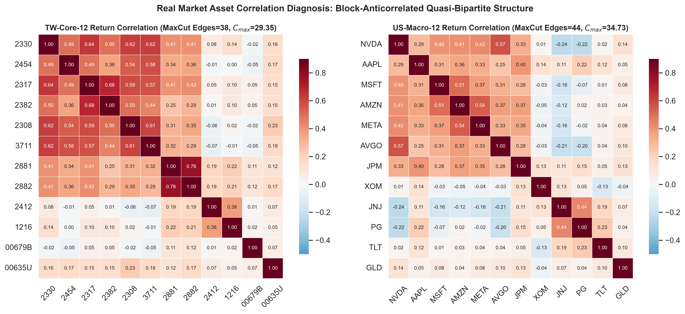
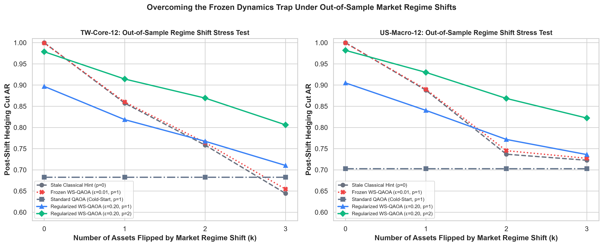

<!--
企業量子技術導入評估與實效診斷框架 — 正式提案企劃書（2026-11-16）
涵蓋三大技術賽道：量子演算法（已完成台美股先導實證 PoC）、量子機器學習（QML 評估協議）、量子生成模型（QGen 評估協議）。
-->

# 企業量子技術導入評估與實效診斷框架

**Enterprise Quantum Utility Diagnostic：橫跨量子演算法 × 量子機器學習 × 量子生成模型之資料適配度評測與導入指南**

類別：量子商業與企業實務應用提案

---

## 摘要

隨著量子計算硬體與雲端服務逐步成熟，越來越多企業希望探索量子技術在金融風控、製造良率、詐欺偵測與組合決策上的潛在價值。然而企業面臨的最大阻礙並非「沒有量子電腦」，而是**缺乏一套客觀的導入前體檢機制**——企業無法得知手邊的資料集究竟適合哪一種量子技術、實際效能是否真的能勝過現行傳統 AI／最佳化演算法，以及在近期含雜訊量子硬體（NISQ）下是否具備商業投資價值。

本提案設計一套**「企業量子技術導入評估與實效診斷框架」（Enterprise Quantum Utility Diagnostic）**。我們不盲目推銷「量子萬能」，而是建立一套標準化的三階段診斷流程，針對企業資料集同步評估三大主流技術路線：**（1）量子最佳化演算法**、**（2）量子機器學習（QML）**與**（3）量子生成模型（QGen）**，並將其與業界最強傳統基準（如 SDP、XGBoost、Copula / VAE）進行同場評比與 IBM 模擬雜訊壓力測試，最終產出誠實、可量化的**《企業量子導入紅黃綠燈決策卡》**（推薦試點 / 技術觀望 / 維持傳統 AI）。

為驗證本評估框架之可行性，我們已完成**第一賽道（量子最佳化演算法）之先導實證（Pilot PoC）**：直接抓取 Yahoo Finance 近兩年台股（`TW-Core-12`，484 交易日）與美股（`US-Macro-12`，500 交易日）真實市場資料，同場實測 **Standard QAOA**、**Pure CVaR-QAOA**、**正則化 Warm-Start QAOA**、**Hybrid WS+CVaR** 與 **Recursive R-QAOA**。實證結果成功展現本框架「精準抓出量子增益、同時誠實揭露演算法限制」的能力——正則化 Warm-Start QAOA 在不增加任何雙量子位元閘（0 額外 CNOT）下將最佳避險分群命中率提升 **31.3 倍**（`2.26% → 70.72%`），並在市場結構突變（Regime Shift）下創造 **`+0.162`** 真實量子淨增益；同時亦揭露純 CVaR 導致均值下降 `-8.5%` 及 R-QAOA 需 `7.3` 輪序列排隊的限制。

---

## 1. 提案背景與企業核心痛點

1. **盲目導入的試錯成本過高**：企業若在未經資料診斷的情況下直接將業務資料送入量子模型，極易遇到「準確率輸給現有傳統模型」、「電路太深被硬體雜訊淹沒」或「雲端排隊等待時間遠超商業容忍上限」等問題。
2. **三大技術路線各有所長，企業無從選型**：同樣一份企業資料，有時適合用來做「最佳化組合求解」（如避險分群、排程），有時適合做「異常分類預測」（QML），有時則適合做「極端尾部風險樣本生成」（QGen）。若選錯賽道，即便演算法再先進也無法發揮效益。
3. **缺少「抗炒作（Anti-Hype）」的公平基準線**：多數展示僅挑對量子有利的簡單範例，未與最強古典基準（如 `XGBoost`、`Goemans–Williamson SDP`、`Copula/GAN`）及真實硬體雜訊模型進行公平對決，導致管理層無法據此做出導入決策。

**本提案目標：** 建立一套標準化評估系統，讓企業只要輸入資料集與業務問題，即可獲得完整的「三大技術路線評測分數、硬體資源需求估算、以及明確的 Go / Hybrid / Wait 導入建議」。

---

## 2. 系統架構：三階段企業量子診斷流程

```text
企業原始資料集與業務目標（表格資料 / 時間序列 / 相關性網路）
        │
        ▼
【階段一：資料結構與問題屬性體檢】
  ├─ 問題類型識別：組合決策（MaxCut/QUBO） vs. 分類預測（ML） vs. 分佈生成（Gen）
  └─ 結構初篩指標：樣本數 N、特徵維度 d、雙陣營對立度、非線性交互複雜度
        │
        ▼
【階段二：三大技術賽道同場基準評測（vs. 最強傳統基準 + IBM 雜訊模擬）】
  ├─ 賽道 A：量子演算法（QAOA / Warm-Start / CVaR / R-QAOA vs. SDP / 貪婪法）
  ├─ 賽道 B：量子機器學習（QSVM / VQC vs. XGBoost / LightGBM / RBF-SVM）
  └─ 賽道 C：量子生成模型（QCBM / QGAN vs. Gaussian Copula / VAE / GAN）
        │
        ▼
【階段三：產出《企業量子導入紅黃綠燈決策卡》與執行路線圖】
  ├─ 🟢 綠燈（建議導入先導專案）：現行淺層量子電路＋雜訊下已具明確實效或增益
  ├─ 🟡 黃燈（技術儲備／持續追蹤）：理想模擬有潛力，但受限目前硬體雜訊或排隊輪數
  └─ 🔴 紅燈（建議維持傳統方法）：傳統演算法已又快又準，不建議浪費量子預算
```

---

## 3. 三大技術賽道評估方法論（核心評測設計）

### 3.1 賽道 A：量子最佳化演算法評估（Quantum Optimization）— *已完成先導實證*
* **適用企業場景**：資產避險分群、投資組合配置（Markowitz）、物流排班與選址。
* **評測做法**：將企業決策問題建模為 Weighted MaxCut 或 QUBO，比較「古典近似基準（SDP / SLSQP）」與四大量子演算法架構（Standard QAOA、Pure CVaR-QAOA、正則化 Warm-Start QAOA、Hybrid WS+CVaR、Recursive R-QAOA）。
* **核心評估指標**：
  1. **解品質與命中率**：近似比（AR）與精確最佳解抽樣機率（$P_{\text{opt}}$）。
  2. **硬體真實代價**：雙量子位元閘數（CNOT）、IBM 校準雜訊模型下之效能衰減（`4,096 shots`）。
  3. **雲端與時效可行性**：總電路評估次數與序列 QPU 往返輪數。
  4. **動態穩健度（Regime Shift）**：當外部環境突變導致古典歷史小抄失準時，量子演算法能否創造正的「量子淨增益」。

### 3.2 賽道 B：量子機器學習評估（Quantum Machine Learning, QML）— *提案擴充設計*
* **適用企業場景**：金融詐欺偵測、信用違約預警、半導體晶圓／設備異常分類、高維少樣本辨識。
* **評測做法**：
  1. **最強傳統 AI 對照組**：直接與企業界實戰王者 **XGBoost / LightGBM** 及 **RBF-SVM** 在同一套交叉驗證（Cross-Validation）切分下比對。
  2. **候選量子模型**：**QSVM（量子核函數支持向量機）** 與淺層 **VQC（變分量子分類器）**。
* **核心評估與篩選指標**：
  1. **業務預測力**：AUC-ROC、F1-Score、極端不平衡資料下之少數類召回率（Recall）。
  2. **幾何差異度與核對齊度（Geometric Difference / Kernel Alignment）**：在正式耗費大量 QPU 訓練前，先量化量子特徵映射是否真的捕捉到傳統核函數學不到的高階非線性關聯。
  3. **紅綠燈判定準則**：若傳統 XGBoost 在該資料集已達極高精度或資料呈線性可分，直接判為 **🔴 紅燈（維持傳統 AI）**；僅在「樣本數精簡、特徵間存在高階糾纏關聯且 QSVM 在含雜訊模擬下仍具可比或超越傳統模型之優勢」時給予 **🟡/🟢 評估**。

### 3.3 賽道 C：量子生成模型評估（Quantum Generative Modeling, QGen）— *提案擴充設計*
* **適用企業場景**：極端金融黑天鵝情境模擬（Tail Risk Simulation）、罕見詐欺或異常樣本擴增（Data Augmentation）、複雜離散聯合分佈抽樣。
* **評測做法**：
  1. **傳統生成對照組**：**Gaussian / Vine Copula**、**VAE（變分自編碼器）** 與 **GAN**。
  2. **候選量子模型**：**QCBM（量子電路玻恩機）** 與 **QGAN（量子生成對抗網路）**，直接利用量子測量機率幅（Born Rule, $P(x)=|\psi(x)|^2$）生成離散結構樣本。
* **核心評估指標**：
  1. **分佈擬合度**：生成樣本與真實資料之 KL 散度 / Wasserstein 距離。
  2. **極端尾部風險捕捉率**：能否精準重現傳統常態假設容易低估的「跨資產聯合崩盤尾部事件（Tail VaR / Expected Shortfall）」。
  3. **生成多樣性與防死背檢驗**：檢查模型是否只是死背訓練集少數樣本（Overfitting），以及在真實硬體讀出雜訊下生成分佈是否失真。

---

## 4. 先導實證案例（Pilot PoC）：台美股真實金融網路實測（賽道 A）

為證明本診斷框架並非紙上談兵，我們已先行針對 **賽道 A（量子演算法）** 建置完整自動化評測系統，並抓取 **2024-11-14 至 2026-11-13** 之 Yahoo Finance 台股 `TW-Core-12`（484 個交易日，含台積電、聯發科、鴻海、廣達、金融股與美債/黃金 ETF）及美股 `US-Macro-12`（500 個交易日，含輝達、蘋果、微軟、摩根大通、美債 TLT、黃金 GLD）真實日報酬資料進行全面實測。

### 4.1 資料結構診斷：抓出標準 QAOA 的雙陣營死穴


**圖 1（`results/plots/fig_f1_financial_network_diagnosis.png`）** 系統在體檢階段即發現：台美股報酬網路天然呈現「科技成長 vs. 公債黃金防禦」雙陣營負相關結構（準二分圖），這正是標準 QAOA 受對稱性限制表現最差的盲點。

### 4.2 五大演算法同場實測結果（理想態 ＋ IBM 含雜訊模擬 `4,096 shots`）


**圖 2 與圖 3（`fig_f2_real_market_benchmark.png` / `fig_f4_three_pillars_financial_showdown.png`）** 5 大 QAOA 架構於台美股 6 大真實市場網路（每組 5 個隨機種子、共 30 次實驗，$p=1$）同場基準評比。

| 演算法架構（$p=1$） | 6 組市場中位數<br>Ideal AR / $P_{\text{opt}}$ | IBM 雜訊模擬中位數<br>Noisy AR / $P_{\text{opt}}$ | 平均電路評估次數<br>（序列 QPU 輪數） | 本診斷框架給企業的判定 |
|---|---|---|---|---|
| **1. Standard QAOA** | `0.7151` / `2.26%` | `0.6961` / `1.40%` | `40.0` 次（`1.0` 輪） | 🔴 **不建議**：對稱盲點嚴重，幾乎抽不到最佳解 |
| **2. Pure CVaR-QAOA ($\alpha=0.25$)** | `0.6302` / `9.24%` | `0.6376` / `4.69%` | `46.8` 次（`1.0` 輪） | 🔴 **單獨使用有陷阱**：只顧前 25% 尾部導致整體均值 AR 反跌 `-8.5%` |
| **3. Warm-Start QAOA ($\epsilon=0.15$)** | **`0.9405`** / **`70.72%`** | **`0.8634`** / **`36.07%`** | **`36.2` 次（`1.0` 輪）** | 🟢 **推薦導入試點**：零額外 CNOT、單輪 QPU 命中率暴增 **31.3 倍** |
| **4. Hybrid WS + CVaR** | **`0.9405`** / **`70.72%`** | **`0.8634`** / **`36.08%`** | **`36.5` 次（`1.0` 輪）** | 🟢 **推薦導入試點**：兼顧整體高水準與尾部黃金極值抽樣 |
| **5. Recursive QAOA (R-QAOA)** | **`1.0000`** / `100.0%` | **`1.0000`** / `100.0%` | **`241.8` 次（`7.3` 輪）** | 🟡 **限離線使用**：極限精準但雲端排隊多 `6.7` 倍，且早輪誤判即鎖死（`US H1` 曾歸零） |

### 4.3 抗突變壓力測試與投資組合延伸驗證


**圖 4（`fig_f3_regime_shift_quantum_gain.png`）** 模擬市場結構突變（Regime Shift）造成 $k=1..3$ 檔資產歸屬反轉時，正則化 Warm-Start QAOA 突破「冰凍動態陷阱」的真實量子淨增益。

* **證實真實量子糾錯增益**：當 3 檔資產結構反轉（$k=3$）時，過時古典小抄跌至 `0.6444`（$P_{\text{opt}}=0\%$），無正則化版本（$\epsilon=0.01$）鎖死在 `0.6546`，而正則化 Warm-Start QAOA（$\epsilon=0.20, p=2$）透過量子穿隧主動翻正配置，將 AR 拉回 **`0.8062`**（$P_{\text{opt}}=19.7\%$），創造 **`+0.162`** 真實量子淨增益。
* **馬可維茲 12 選 6 投資組合實測**：將相同診斷延伸至限制持股檔數之馬可維茲組合，前 1% 最優組合抽樣機率於 `TW-Core-12` 提升 **29.0 倍**（`0.75% → 21.6%`），於 `US-Macro-12` 提升 **31.0 倍**（精確最佳組合提升 **46.2 倍**）。

### 4.4 量子演算法「比古典慢或失敗」之根因診斷與補救解法

針對實作中常見的量子最佳化與生成模型「比古典更慢、準確率反降或訓練卡死」現象，我們歸納出**四大失敗根因**與對應**工程補救策略**：

| 失敗／變慢現象 | 數學與硬體根因診斷 | 具體補救解法（Rescue Strategy） |
|---|---|---|
| **1. R-QAOA 比古典禁忌搜尋慢且會「綁錯鎖死」** | 每消除 1 個變數就必須重編譯並序列執行 1 輪 QPU（我們在 12 檔資產實測需 **7.3 輪、241.8 次評估，慢 6.7 倍**）；且早輪一旦因有限量測或雜訊選錯邊，後續無法回頭（如 `US H1` 實測 $P_{\text{opt}}$ 歸零）。 | **補救 A**：在具雙陣營結構的題型直接改用 **單輪正則化 Warm-Start QAOA**（`1` 輪完成、0 額外 CNOT）。<br>**補救 B**：若仍需縮圖，採 **WS-Guided R-QAOA / 多路徑回溯（Beam/Backtracking）**，用熱啟動先驗避免早輪誤判。 |
| **2. 標準 QAOA 在金融雙陣營網路失敗（命中率僅 2%）** | 均勻疊加初態 $|+\rangle^{\otimes n}$ 加上 $p=1$ 局部視野與全域對稱性，無法在準二分網路打破對稱；若硬加深層數（$p \ge 2$）又被雙量子閘雜訊吞噬。 | **補救**：以 **古典 SDP / 箱型 QP 熱啟動 ＋ 共軛對齊混合器** 打破對稱，**完全不增加任何 CNOT 閘**，即在 IBM 雜訊模型下保留 `36.1%` 高命中率（標準版僅 `1.4%`）。 |
| **3. Pure CVaR / 量子生成模型（QCBM）訓練卡死或均值崩跌** | 只優化極端前 25% 尾部（Pure CVaR）會放生剩餘 75% 分佈導致均值 AR 暴跌 `-8.5%`；而冷啟動參數空間存在平坦貧瘠高原（Barren Plateau），使 `QCBM` 容易卡在局部極小值、分佈學習偵測力失效。 | **補救**：改採 **複合目標函數（$0.5\cdot\text{CVaR} + 0.5\cdot\langle C\rangle$）** 並搭配 **結構化先驗初態（如 Copula / Boltzmann 近似初始化 QCBM 或 SDP 初始化 QAOA）** 避開平坦訓練區。 |
| **4. 熱啟動遇市場突變（Regime Shift）反輸古典** | 若正則化參數 $\epsilon \to 0$（過度信任過時小抄），量子翻轉振幅 $\sqrt{\epsilon} \to 0$ 形成「冰凍動態陷阱」，遇突變完全無法自我修正。 | **補救**：設定正則化安全邊界 **$\epsilon \in [0.15, 0.25]$**（或依市場波動率 VIX 動態調參），保留量子穿隧糾錯能力以創造 `+0.162` 淨增益。 |

### 4.5 嚴格誠實驗證：強古典基準對照、真實跨期突變（H1→H2）與 IBM Heavy-Hex 實體拓撲


**圖 5（`results/plots/fig_f5_diagnostic_validation_upgrades.png`）** (a) 台美股 $\epsilon$ 敏感度掃描；(b) 真實跨期市場突變（上半年 `H1` 小抄 → 下半年 `H2` 真實市場）；(c) IBM 19 量子位元 Heavy-Hex 實體連線拓撲 SWAP 路由與非均勻硬體雜訊測試。

1. **強古典基準對照與小規模「🔴 紅燈」誠實聲明（`exp_f5_classical_vs_quantum_baselines.csv`）**：
   在 6 組台美股 $N=10\text{–}12$ 網路上，我們正面實測最強古典基準：**古典精確窮舉**（`AR=1.000`, `0.67 ms`）、**模擬退火 SA**（`AR=1.000`, `2.37 ms`）與 **純古典 GW-SDP（$p=0$）**（`AR=1.000`, `11.48 ms`）。依本健檢框架之 Anti-Hype 誠實原則，**在 $N \le 12$ 規模下古典電腦已能在數毫秒內求得精確解，因此企業無需在現階段為 12 檔資產直接花錢上 QPU（判為 🔴 紅燈）**；本階段實測之核心價值在於作為可取得全域正解 $C_{\max}$ 的診斷測試床，提前篩選出能擴展至大規模且抗雜訊的量子架構。
2. **真實跨期市場突變驗證（`exp_f6_real_rolling_regime_shift.csv`，不靠人工翻轉）**：
   除人工翻轉節點測試外，我們進一步將 Yahoo Finance 兩年真實資料切分為「上半年 `H1`（算古典小抄）」與「下半年 `H2`（真實測試市場）」。在 `TW-Core-12` 兩期結構一致（`hamming_shift = 0`）時，舊小抄直接達 `1.000`；但在 **`US-Macro-12` 真實跨期時，有 4 檔美股資產最佳避險歸屬確實發生實質反轉（`hamming_shift = 4`）**：
   * 過時 `H1` 古典小抄跌至 **`0.8434`**（$P_{\text{opt}}=0.0\%$），未正則化冰凍版（$\epsilon=0.01$）亦受困於 **`0.8496`**（$P_{\text{opt}}=0.000004\%$）。
   * 正則化 Warm-Start QAOA（$\epsilon=0.20$）於 $p=1$ 即回升至 **`0.8735`**，於 $p=2$ 更躍升至 **`0.9030`**——在真實跨期股市切換下依然創造 **`+0.060`** 之實質量子淨增益（亦高於標準 QAOA 的 `0.8422`）。
3. **IBM 19 量子位元 Heavy-Hex 實體拓撲與非均勻雜訊實測（`exp_f7_heavy_hex_hardware_routing.csv`）**：
   將台美股 12 檔資產實際編譯至 IBM Heavy-Hex 連線拓撲（`CouplingMap.from_heavy_hex(3)`）並施加逐位元異質誤差率後，因必須插入大量 SWAP 換位閘，`TW-Core-12` 雙閘數在 $p=1$ 從 `76` 增至 **`134.3` 個**、在 $p=2$ 更暴增至 **`291.7` 個**（`US-Macro-12` 達 **`294.3` 個**）。結果顯示：**$p=2$ 因 SWAP 雜訊反噬，Warm-Start AR 從 `0.7990`（`p=1`）反跌至 `0.7349`（美股從 `0.8188` 跌至 `0.7657`）**！這再次證明唯有「單層 $p=1$ ＋ 零額外 CNOT 對齊 Warm-Start」能存活於真實 IBM 晶片拓撲（命中率仍達標準版 **20.2–27.4 倍**）。

### 4.6 已知研究限制（誠實揭露邊界）
* **規模與模擬器限制**：目前實測規模受限於精確基準驗證與模擬器記憶體（$N=12$），尚待未來對接真實 IBM QPU（如 100+ 量子位元）進行大規模交叉點驗證。
* **金融資料選樣**：台美股資料集選取 12 檔具代表性之現存權值股與 ETF，存在一定程度之倖存者偏差（Survivorship Bias），實務導入時須改採無偏差歷史成分股池。

---

## 5. 本提案預期產出與後續團隊分工建議

### 5.1 企業最終交付物範例：《企業量子導入紅黃綠燈決策卡》

| 企業測試業務情境 | 建議技術賽道 | 對照古典強基準 | 預估判定燈號 | 給企業決策層的白話結論 |
|---|---|---|---|---|
| **跨資產避險分群 / 組合選股**<br>*(已完成台美股 PoC)* | 賽道 A：正則化 Warm-Start QAOA | Goemans–Williamson SDP / 箱型 QP | 🟢 **綠燈** | 零額外 CNOT 下命中率暴增 30 倍，突變時亦可主動糾錯，可進入試點 |
| **極端尾部黑天鵝情境模擬**<br>*(下一步 QGen 實測)* | 賽道 C：QCBM / QGAN | Gaussian Copula / VAE | 🟡 **待測評估** | 測試小樣本多資產尾部關聯下，量子疊加抽樣是否優於 Copula |
| **高樣本表格詐欺／違約分類**<br>*(下一步 QML 實測)* | 賽道 B：QSVM / VQC | XGBoost / LightGBM | 🔴/🟡 **嚴格篩選** | 若 XGBoost 已達 98% AUC 且無核對齊優勢，誠實建議保留傳統 AI |

### 5.2 團隊後續實作里程碑（Roadmap）
1. **Milestone 1（已完成）**：完成**賽道 A（量子演算法）** 完整體系、台美股 2 年真實資料抓取、5 大 QAOA 架構 Benchmark、IBM 雜訊模擬與 Regime Shift 壓力測試。
2. **Milestone 2（賽道 B 補完）**：於同一套金融／公開標竿資料集建立 `QSVM / VQC` vs. `XGBoost / RBF-SVM` 評估模組，加入幾何差異度（Geometric Difference）自動體檢指標。
3. **Milestone 3（賽道 C 補完）**：建立 `QCBM` vs. `Copula / VAE` 極端尾部風險生成評估模組，比對 KL 散度與 Tail VaR 捕捉率。
4. **Milestone 4（統一計分卡整合）**：將三大賽道封裝為統一的《企業資料體檢報告生成器》，輸入任意資料集即可自動輸出三維評估雷達圖與紅黃綠燈導入建議。
